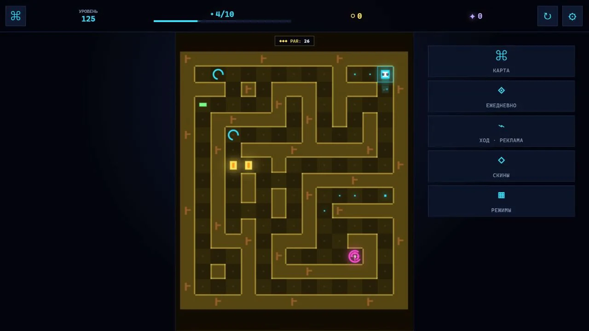
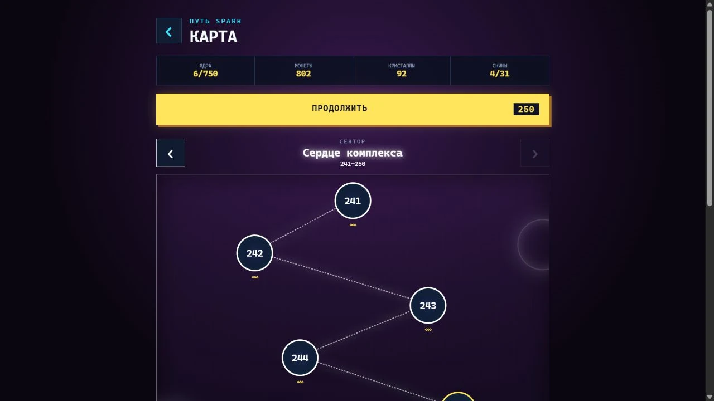

# Neon Vaults: Лабиринты / Neon Vaults

Оригинальная HTML5-аркада-головоломка для Яндекс Игр. Спарк скользит до ближайшего препятствия, собирает энергию и монеты, избегает механизмов древнего цифрового комплекса и проходит 250 статических уровней.

## Скриншоты





Кадр игрового процесса взят из записи игры.

## Быстрый запуск

```powershell
npm install
npm run qa
python -m http.server 4173
```

Открыть `http://127.0.0.1:4173/`. Production ZIP создаётся командой `npm run package`.

Для ручной проверки 20 эталонных уровней сначала выполнить `npm run analyze:levels` и `npm run levels:pilot`, затем открыть `http://127.0.0.1:4173/tools/pilot-review.html`. Экран сравнивает текущую карту с тремя кандидатами и воспроизводит оптимальный маршрут; production-уровни при этом не изменяются.

## Что входит

- 250 уникальных статических конфигураций в пяти файлах по 50 уровней;
- независимый dash-solver и production-валидатор, подтверждающий 250/250 обязательных и бонусных маршрутов; динамические ловушки дополнительно проигрываются реальным runtime на 30/60/120 FPS;
- swipe/drag, стрелки, WASD через `KeyboardEvent.code` и буфер следующего направления;
- обязательный сбор всех точек: выход включается только после полной зачистки маршрута;
- монеты, редкие кристаллы, 3 энергетических ядра за эффективность маршрута и быстрая цепочка restart/next;
- статические и циклические шипы, moving hazards, пушки, разрушаемые блоки, one-way gates, враги, порталы, переключатели, timed gates, direction changers, crumble tiles, pulse fields и checkpoints;
- рискованные тайники за частью разрушаемых стен: одноразовые монеты, кристаллы и короткий overdrive-эффект с сохранением найденного; overdrive реально ускоряет Spark и подсвечивается кольцом;
- закрытый портал отталкивает Spark на клетку назад, мигает красным и показывает точное число оставшихся точек;
- 44 скина с отдельными визуальными эффектами, включая более контрастный Obsidian, 13 уникальных sector-sigil за полные зоны и финальный Vault Architect; закрытые облики можно посмотреть силуэтом, открытые — в цикле покоя, движения, столкновения и портала;
- два duplicate-free сундука: обычный за монеты и редкий за кристаллы, оба с анимированной прокруткой;
- постоянная rewarded-награда `+50` монет и бонус `+100` монет / `+2` кристалла после каждого пятого уровня;
- главный экран с выровненным быстрым продолжением и статичной иллюстрацией `assets/ui/hero.webp` без движущихся слоёв поверх;
- новая маршрутная карта без показа всех 250 уровней сразу и 13 цветовых зон по 20 уровней;
- ежедневный игровой раздел, детерминированный датой уровень, локальная десятка результатов и разделённая по UTC-дням отправка очков в Yandex Games leaderboard `neonvaultsdaily`;
- отдельный режим Vault Rush с таймером, множителем, серией без смертей, возрастающим security level, локальным рекордом и leaderboard `neonvaultsrush`;
- ежедневные задания с наградой, сохранение лучших времён и настройки громкости, чувствительности свайпа, анимации и вибрации;
- настоящие checkpoints с восстановлением состояния маршрута, индикатор сбора точек и отметки новых личных рекордов;
- статистика прогресса (прохождения, идеальные забеги, смерти, лучшая серия и собранные точки), история последних наград и метрики качества маршрутов в `src/levels/metrics.json`;
- RU/EN, local save, безопасный versioned merge с cloud save без восстановления уже потраченной валюты;
- официальный Yandex Games SDK, LoadingAPI, GameplayAPI, rewarded и fullscreen ads;
- Yandex Games leaderboards API с безопасным fallback для локального запуска без SDK;
- responsive portrait/landscape/desktop Canvas UI;
- кэш статического слоя игрового Canvas, in-place очистка кадровых эффектов и ограничение DPR для слабых устройств;
- локальная privacy-friendly аналитика событий и per-level counters (старты, победы, смерти, рывки, рестарты, реклама, выбор скинов) с безопасным cloud merge;
- общая музыкальная тема с 13 секторными тембровыми профилями: меняются волна баса, лид и перкуссия, а динамическая интенсивность сохраняется;
- сбалансированная экономика: обычный сундук рассчитан примерно на 8–12 прохождений, кристальный стартует с 20 кристаллов и растёт плавно до 31;
- пять визуальных контрольных точек (уровни 1, 20, 100, 200 и 250) проверяются без тяжёлых графических зависимостей;
- оригинальная программная pixel-art графика и синтезированная Web Audio музыка/SFX без внешних аудиофайлов.

## Звук

`src/audio.js` создаёт оригинальный саундтрек в реальном времени: 112 BPM секвенсор, мягкий бас, пентатоническая мелодия, приглушённая перкуссия и динамическая интенсивность. SFX используют отдельную шину, компрессию и короткое эхо. Dash, wall impact, dot, coin, switch, teleport, hazard, death, exit, checkpoint и chest имеют собственные многослойные сигналы. Музыка и эффекты независимо отключаются и корректно ставятся на паузу рекламой/системными событиями.

## Структура

- `src/game.js` — детерминированная grid-логика;
- `src/renderer.js` — Canvas pixel renderer игрового поля;
- `src/hero-preview.js` — экспериментальный генератор маршрута для тестов; стартовый экран его не запускает;
- `src/audio.js` — Web Audio soundtrack и SFX;
- `src/levels/` — 250 статических конфигураций и метрики;
- `src/level-validator.js` — solver/validator;
- `src/save.js`, `src/yandex.js` — сохранения и платформа;
- `scripts/generate-levels.mjs` — воспроизводимая подготовка level data;
- `tests/` — минимальные runnable checks;
- `store-assets/` — материалы карточки игры; точный список разрешённых к загрузке файлов находится в `store-assets/UPLOAD-MANIFEST-2026-09-09.md`.

## Релиз для Яндекс Игр

`npm run package` пересобирает исходники, выполняет весь машинный QA и создаёт `neon-vaults-yandex.zip`. Архив содержит только `index.html`, `dist/game.js`, `dist/styles.css` и `assets/ui/hero.webp`; служебные панели и отладочные файлы в него не входят.

Для глобальных рейтингов используются таблицы `neonvaultsdaily` и `neonvaultsrush`; без них игра продолжает работать с локальными рекордами. В собственном UI отображается только нейтральная кнопка входа, а официальный диалог авторизации вызывается через SDK исключительно после явного действия игрока.

Названия релиза фиксированы: `Neon Vaults: Лабиринты` для RU и `Neon Vaults` для EN. Рабочее имя пакета остаётся `neon-vaults`.
